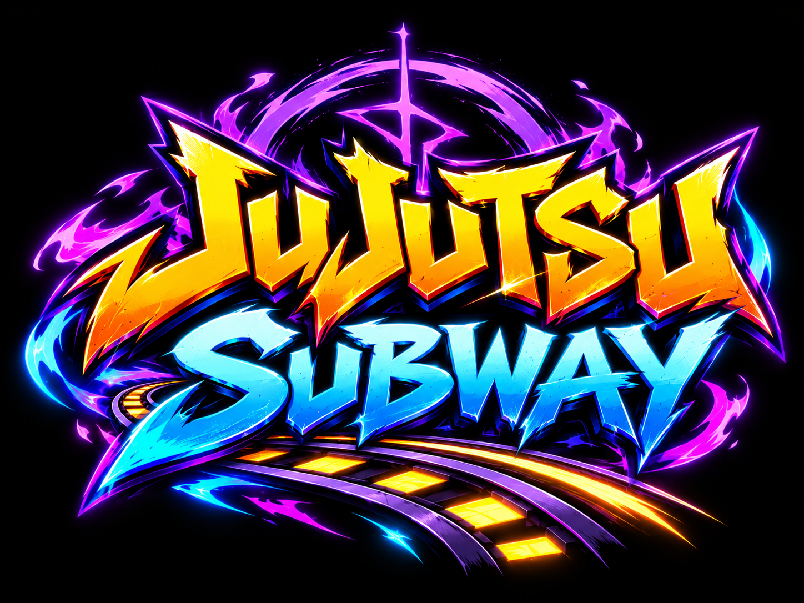

Juego de avance automático con cinco carriles y patineta.

### Lobby y partidas

Todos los jugadores aparecen en una lobby con movimiento libre. **AFK** permite entrar o salir de las convocatorias automáticas. **Jugar solo** abre una pista de práctica independiente; **Terminar** devuelve al jugador a la lobby. Las prácticas tienen sus propios escenarios, monedas y trenes, y no incluyen al jugador en las carreras.

Cada **10 segundos** de espera se convoca a todos los jugadores listos que estén en la lobby sin AFK. Si no hay candidatos, se mantiene la espera; también se puede iniciar una carrera con un único candidato. Quien llega durante una carrera espera a la siguiente. Solo está disponible el modo **Carrera**, registrado en `GameConfig.Matches.Modes` para poder incorporar otros modos después.

La carrera tiene una meta visible a **3.600 studs** y un máximo de **180 segundos**. A la velocidad inicial de 26 studs/s, recorrerla sin acelerar lleva aproximadamente **138 segundos**: deja unos 42 segundos para errores, mientras las monedas permiten acabar antes. Se muestra el tiempo restante, progreso, puesto y clasificación. El servidor registra el cruce de meta y ordena los tiempos de llegada.

Llegar a la meta no termina la ronda: el jugador queda en estado `Finished`, conserva puesto/tiempo/distancia final y entra en espectador. No vuelve a la convocatoria hasta que termina la carrera. Los demás competidores siguen hasta la meta o el límite de tres minutos. Solo cuando todos terminan (o ya no quedan competidores activos por retiros) empieza otra espera de 10 segundos. Las desconexiones o reinicios de personaje retiran al competidor. Los choques normales conservan la pérdida de monedas y el retroceso, sin eliminarlo de la carrera.

Los jugadores comparten el recorrido competitivo, sin colisiones físicas entre personajes. La práctica usa pistas separadas. Las monedas y la progresión se reinician al empezar cada práctica o carrera. Los escenarios se destruyen al terminar su sesión. Distancia, duración y espera se ajustan en `GameConfig.Matches`; `CoinMode` selecciona las reglas de monedas/velocidad de cada modo.

### Interfaz, equipos y espectador

AFK y Jugar solo están abajo a la derecha; Terminar aparece allí durante la práctica. Las monedas aparecen abajo a la izquierda. La interfaz normal muestra tiempo, puesto y distancia, sin velocidad ni datos técnicos. Se elimina el menú central.

La lista genérica de Roblox se oculta y se sustituye por una tabla propia con equipos reales `Jugando` y `AFK`. `Jugando` agrupa carreras y prácticas: primero se ordena la carrera por puesto, después las prácticas por distancia. Se muestran studs y monedas de cada jugador. `AFK` agrupa a quienes están en lobby o ya terminaron, incluyendo los que esperan la próxima convocatoria. La etiqueta de cada fila distingue Lobby, AFK y En meta. TAB o el encabezado permite plegar la tabla.

Durante una carrera en curso, cualquier jugador de la lobby puede observar a los corredores sin activar AFK. También se conserva el acceso para jugadores AFK o en estado Finished. Se puede pulsar Espectar o seleccionar un corredor en la tabla; las flechas del panel de espectador y Q/E cambian el objetivo. Salir de espectador devuelve la cámara al propio personaje. Al llegar a meta se observa automáticamente a los que siguen corriendo. Si el objetivo termina, se desconecta o reaparece, se busca otro válido. La autorización y selección de objetivos se validan en el servidor. Observar sin AFK no excluye de la próxima convocatoria.

El controlador de cámara es independiente del HUD y comparte la misma perspectiva para jugar y espectar. El servidor centra la replicación en el corredor observado y envía posiciones de respaldo; el cliente solicita cargar su entorno. Si el personaje lejano aún no está disponible, la cámara sigue esos datos en lugar de volver al avatar de la lobby. Al salir se restauran la cámara personal y el foco de replicación.

### Panel de desarrollo

El comando de chat `/menu` abre o cierra un panel compacto y plegable arriba a la izquierda, con pestañas Estado y Mundo. Muestra velocidad objetivo/real, estados, carril, tiempo de cambio, monedas, recogidas, distancia, rampa, agachado, protección, FPS, ronda, reloj y recuentos de mundos/tramos/trenes/corredores.

El creador de una experiencia de propietario individual tiene acceso. Para otros desarrolladores, añade sus UserIds en `GameConfig.Developers.UserIds`; para experiencias de grupo se utiliza esta lista explícita. `AllowStudio = true` habilita las pruebas locales de Studio, sin conceder acceso a usuarios normales en servidores publicados. El servidor valida el comando y envía la telemetría únicamente a desarrolladores autorizados que tienen el panel abierto. No se publica un atributo de velocidad en el HUD ni en la clasificación.

Controles: **A** izquierda, **W** salto, **D** derecha y mantener **S** para agacharse. También funcionan las flechas y Espacio para saltar. En el aire, agacharse cancela el salto y fuerza una caída rápida; al soltar, el personaje se levanta sin recuperar el impulso del salto. No se puede saltar mientras está agachado. En mando: cruceta para carriles, A para saltar y B para agacharse; en móvil hay botones táctiles.

La reducción de altura y velocidad de caída se ajustan en `GameConfig.Crouch`. La patineta conserva su altura respecto al suelo al agacharse. Pulsar salto cancela la postura agachada sin exigir soltar antes la tecla. `JumpBuffer = 0.2` guarda la pulsación durante 200 ms para saltar al tocar suelo si se pulsa un poco antes de aterrizar; no permite un segundo salto en el aire. Volver a agacharse o chocar cancela la solicitud pendiente.

Cada moneda recogida aumenta la velocidad objetivo en **0.2 studs/s**, desde **26** hasta **42 studs/s** en Classic (80 monedas). Cada recogida contribuye, sin escalones de 20 monedas, y la velocidad real se aproxima al objetivo con una aceleración máxima de **6 studs/s²**. El máximo más cercano a la velocidad inicial reduce la ventaja de quienes llevan muchas monedas frente a quien acaba de chocar. La progresión cuenta monedas físicas recogidas en la carrera actual, independientemente de su valor, y vuelve a la velocidad inicial al chocar o reaparecer. Al chocar se pierden todas las monedas acumuladas. La velocidad solo se muestra en el panel de desarrollo autorizado.

Edita `GameConfig.Speed` (`Base`, `PerCoin`, `Max`, `Acceleration`) para ajustar la progresión general. Cada configuración de monedas puede incluir su propia tabla `Speed`: CoinRush permite llegar a 48 y NoCoins mantiene 26.

Las monedas también hacen más lento el cambio entre carriles: empieza en **0.2 s** por carril, suma **0.005 s** por moneda recogida y alcanza un máximo de **0.6 s** a las 80 monedas. Sigue bastando una pulsación; el avance automático mantiene su velocidad. La dificultad vuelve al inicio al chocar o reaparecer. Ajusta `GameConfig.LaneChange` (`BaseDuration`, `SecondsPerCoin`, `MaxDuration`) o añade una tabla `LaneChange` dentro de un modo para personalizarlo. NoCoins mantiene el cambio en 0.2 s.

### Obstáculos

El recorrido elige tipos sin una secuencia fija, reduce repeticiones inmediatas y varía carriles, anchos, posiciones, colores y combinaciones. Todos los tipos pueden aparecer en cualquier carril; la barrera transversal sigue ocupando los cinco. Puede haber camiones solos, camiones con señales y grupos de uno, dos o tres techos.

- **Camión:** ocupa de uno a tres carriles y mide 16 studs de alto. No se alcanza con un salto desde el suelo, pero se puede recorrer su techo al llegar desde un camión de rampa contiguo.
- **Señalizador elevado:** ocupa de uno a cinco carriles y se pasa manteniendo **S**, o cambiando de carril si queda espacio. Algunos grupos requieren agacharse y después saltar una barrera situada 20 studs más adelante.
- **Barrera transversal:** mide 2.2 studs, ocupa los cinco carriles y exige saltar con **W** (también Espacio).
- **Camión con rampa/escalera de carga:** tiene la misma altura de 16 studs. Puede aparecer solo o junto a otros camiones, con techos alineados que se unen en los límites de los carriles. Algunos grupos tienen una barrera bajo los techos y otros no.
- **Tren en sentido contrario:** avanza recto a 38 studs/s hacia el jugador. Cada tren elige un carril disponible distinto del anterior cuando hay alternativas. Aparece entre 220 y 340 studs por delante, cada 7 a 12 segundos, con un máximo de tres trenes activos. Se comprueba su trayecto contra los obstáculos estáticos; si ninguno está libre, se aplaza la aparición. No cambia de carril durante su recorrido y se elimina al quedar atrás. Su impacto aplica la misma pérdida de monedas y retroceso que el resto. Ajusta estos valores en `GameConfig.Trains`.

Mientras se sube la rampa se desactivan las colisiones físicas y penalizaciones contra el chasis del grupo de camiones, conservando las superficies de rampa y techo. La asistencia ajusta gradualmente la velocidad vertical según la pendiente: no modifica el CFrame ni teletransporta al personaje para corregir su altura. Se puede saltar desde la rampa. La protección termina al salir de la rampa o llegar al techo; otros obstáculos, incluidos los trenes, conservan su detección.

Chocar **no mata ni hace reaparecer al personaje**: se pierden todas las monedas, se reinician la velocidad y la dificultad, y el jugador retrocede al menos 55 studs a una posición libre. Si esa posición coincide con otro obstáculo, se busca otro carril o se retrocede más. Hay una pausa de 0.5 s y protección de 1.25 s para evitar impactos repetidos durante la recuperación. El barrido de colisión y recogida vuelve a empezar en el punto de retroceso, evitando recoger monedas o detectar choques a lo largo del teletransporte. Estos valores se ajustan en `GameConfig.Crash`.

Las colisiones consultan las partes reales del cuerpo y las piezas visibles de cada obstáculo. La cabina baja y la caja del camión se comprueban por separado, sin extender su altura a espacios vacíos. Un barrido entre fotogramas evita omitir impactos rápidos, con una tolerancia de contacto de solo 0.025 studs; en trenes se usa el desplazamiento relativo del jugador y del tren para detectar cruces rápidos. La patineta y los accesorios no provocan choques anticipados. Los techos transitables quedan excluidos al circular sobre ellos. Agacharse a nivel del suelo permite pasar bajo el señalizador, pero los postes siguen siendo obstáculos. No hay carteles de ayuda sobre los obstáculos.

La zona inicial queda libre. Cada tramo de 100 studs tiene un 99 % de probabilidad de generar un grupo, con desplazamientos longitudinales variables. No hay carriles permanentemente reservados: los camiones dejan una ruta que cambia de carril gradualmente y los trenes verifican el espacio disponible antes de aparecer. Cada sesión recibe una nueva semilla de escenario; un atributo `WorldSeed` en Workspace permite fijar la secuencia de semillas del servidor antes de Play. Ajusta `GameConfig.Obstacles` para cambiar frecuencia, variación de posición, ancho máximo y la altura común `TruckHeight`. Las monedas se colocan sobre rampas y techos conectados; se omiten dentro de camiones aislados, señales y barreras. Los obstáculos se eliminan junto con su tramo; los trenes tienen su propio ciclo de movimiento y eliminación.

### Configuración de monedas

La dificultad de obstáculos se ajusta en `GameConfig.Obstacles`: `ExtraTruckChance`, `TruckSignChance`, `WideSignChance`, `SignJumpChance`, `SignJumpOffset` y `RampBarrierChance`. Los grupos favorecen camiones más anchos y combinan otros obstáculos en sus carriles libres. La ruta sin camiones sigue cambiando gradualmente, pero puede exigir agacharse; no hay un carril permanentemente seguro. Las rampas conservan la subida protegida.

Edita `src/shared/GameConfig.luau` para ajustar las reglas. `DefaultMode` selecciona el modo inicial:

- `Classic`: hasta dos filas de tres a seis monedas por tramo, con probabilidad de aparición del 85 % por fila.
- `CoinRush`: cinco filas de seis a diez monedas por tramo; cada moneda vale dos.
- `NoCoins`: sin monedas.

Cada modo admite `Enabled`, `Seed`, `SpawnChance`, `LinesPerChunk`, `MinCoinsPerLine`, `CoinsPerLine`, `Spacing`, `Value`, `Height`, `PickupRadius` y `AllowedLanes`. Los carriles son `{-2, -1, 0, 1, 2}`; el cero es el central. Las filas se limitan al tamaño del tramo y nunca se repite un carril dentro del mismo tramo. Para crear otro modo, añade una entrada a `CoinModes`.

La carrera selecciona sus reglas mediante `GameConfig.Matches.Modes.Race.CoinMode`; la práctica usa `GameConfig.DefaultMode`. La recogida se valida en el servidor y es individual: tomar una moneda no la quita a los demás. Reaparece para quien la recogió después de seis segundos. El total aparece en el HUD y en `leaderstats.Coins`. No hay guardado permanente; el saldo se reinicia al comenzar otra sesión o al chocar.

Los tramos y sus monedas se eliminan cuando quedan lejos de todos los jugadores. La configuración `Track` comparte el ancho y número de carriles entre el movimiento, el escenario y las monedas.

Generated by [Rojo](https://github.com/rojo-rbx/rojo) 7.7.1.

## Getting Started
La postura sobre la patineta se resuelve usando las conexiones reales de los `Motor6D`, sus orientaciones y las dimensiones de los pies. La compensación vertical se aplica al cuerpo para mantener las suelas sobre la tabla, tanto de pie como agachado, sin modificar `HipHeight` ni el anclaje de la patineta. La tabla adapta su ancho a la separación de los pies. Un control visual en cada cliente evita que las animaciones por defecto sobrescriban la postura de los jugadores. Se contemplan rigs R6, R15 y sus escalas; los avatares con esqueletos personalizados requieren comprobación visual.

El HUD muestra solo el reloj centrado, sin panel de carrera, puesto ni distancia. La barra de tiempo ocupa cinco píxeles en el borde superior y crece con el tiempo transcurrido; en eliminación representa los 20 segundos hasta la siguiente captura. La lista de jugadores y TAB quedan arriba a la derecha. Los choques conservan su retroceso y parpadeo, pero no muestran panel ni barra de aviso.

Se revirtió la corrección lateral de posición posterior a la simulación: los cambios de carril vuelven a funcionar por velocidad, sin reposicionar el personaje en cada fotograma. Mientras usa la patineta se desactiva `Animate`, se detienen las animaciones de carrera y se aplica una postura de equilibrio compatible con R6/R15. Agacharse usa esa postura como base; al salir de la sesión se restauran las articulaciones y el estado original del script de animación.

El rayo activa una tormenta visual global de 2,2 segundos: cielo nocturno, iluminación fría, destello y rayos con núcleo blanco y halo azul. Todos los clientes reciben el efecto, aunque estén en la lobby o en otra pista; el daño continúa limitado a los rivales de la misma partida. Los efectos simultáneos prolongan la tormenta sin perder la iluminación original, que se restaura al terminar.

Las zapatillas aplican un multiplicador gradual de 1 a 2 y de vuelta a 1, separado de la velocidad acumulada para evitar multiplicaciones repetidas. Al añadir su modelo se reafirma la propiedad física del servidor. Cada paso de simulación sincroniza la velocidad horizontal real con el objetivo del controlador, conserva la velocidad vertical y elimina la rotación residual para estabilizar el carril durante aceleraciones.

Durante el impulso de zapatillas, la velocidad longitudinal queda limitada a 80 studs/s, con aceleración máxima de 28 studs/s² y frenado de 40 studs/s², incluido el retorno a la velocidad normal. Combinar zapatillas con rebufo o retos respeta ese límite. El control lateral conserva su velocidad independiente del impulso. Cada tramo tiene barreras físicas invisibles en los bordes exteriores de los cinco carriles para contener empujes sin corregir la posición por teletransporte. Estos límites se ajustan en `GameConfig.Abilities`.

El control horizontal usa únicamente `AssemblyLinearVelocity`: se eliminó el actuador `LinearVelocity` para evitar dos controladores simultáneos. No se modifica la posición para mantener el carril ni la velocidad vertical del salto. La aproximación lateral es exponencial y limitada. Las mochilas reaparecen individualmente a los ocho segundos y las monedas a los seis; el servidor exige salir de su radio antes de recoger otra vez. Configura los tiempos en `PowerUps.RespawnTime` y `CoinRespawnTime`.

El huevo y el bumerán tienen contorno y estela luminosos, con modelos más grandes. Al lanzarlos se avisa a los corredores cercanos en la dirección de peligro mediante un «!» proyectado sobre el carril correspondiente; el bumerán avisa tanto a los de atrás como a los de delante por su retorno. Los avisos pertenecen a la misma partida y caducan con la vida del proyectil.

Las recogidas de poderes son mochilas, no habilidades ni rombos. El sorteo contiene cinco ítems reales: bumerán (sale hacia atrás y vuelve hacia delante, un impacto por rival), rayo (aturde un segundo y quita el 30 % de monedas a los rivales de la misma partida), trampa (carnada de tres monedas y ralentización al 60 % durante 2,5 segundos), zapatillas (velocidad ×2 durante cuatro segundos) y huevo (mancha la visión durante 1,5 segundos). El bumerán aplica un tropiezo de 0,45 segundos y pierde el 15 % de monedas del rival. Los ataques no afectan al lanzador ni a otras pistas, respetan la protección tras choques y conceden protección breve contra impactos consecutivos. El huevo se detiene contra el escenario. Las trampas caducan a los 12 segundos. E usa el poder; Mayús + E lanza el huevo hacia atrás, y el botón Frente/Atrás ofrece la misma elección con ratón o pantalla táctil. Ajusta duraciones y penalizaciones en `GameConfig.Abilities`.

Las rondas multijugador alternan Carrera y «Corre que te atrapan» cuando hay al menos dos jugadores listos. En eliminación no hay meta: cada 20 segundos se captura al corredor con menor distancia recorrida y pasa a espectador. Gana el último que queda. Los empates se resuelven por UserId para evitar resultados dependientes del orden de actualización. La clasificación coloca al ganador primero y a los capturados por orden de supervivencia. Con un solo participante se mantiene Carrera; Solitario sigue disponible como práctica independiente.

En carreras, mantenerse entre 4 y 28 studs detrás de otro jugador, a menos de 2,5 studs de diferencia lateral, carga rebufo durante 1,4 segundos. Otorga +6 studs/s durante dos segundos, con tres segundos de descanso posteriores. La carga decae al perder la estela y se cancela al chocar. La barra de rebufo y los efectos de viento indican su estado. El impulso de rebufo y el de ruta no se suman: se aplica el mayor.

Los retos tienen una probabilidad del 55 % de ofrecer dos rutas paralelas con recorridos y recompensas propios, sin cruzarse entre sí. El primero que completa cualquiera de las dos obtiene +2 adicionales; el resto conserva la recompensa normal. Las mochilas de poder aparecen cada dos tramos y tienen recogida individual: cada jugador puede recoger una copia, que desaparece solo para él. Esto permite que quienes vienen detrás sigan obteniendo poderes.

Las mochilas violeta/cian aparecen desde el tramo 2 y cada dos tramos, con recogida individual por barrido validada en el servidor. Otorgan un poder aleatorio de `GameConfig.PowerUps.Catalog`. Solo se guarda uno, no se reemplaza al tocar otra mochila y se conserva al chocar. El botón del HUD, E o X del mando consume y ejecuta el poder. E mantiene su función de espectador cuando corresponde y no consume poderes al escribir en el chat. El inventario se vacía al abandonar o empezar una sesión.

El indicador de monedas recogidas tiene entrada elástica, inclinación amortiguada, rebote vertical y salida ascendente con desvanecimiento. Se reutilizan ocho indicadores independientes para permitir recogidas seguidas sin cortar animaciones. El HUD usa tipografía de arcade, medallón de monedas, reloj separado, barra de progreso dentro del marcador y colores por función. El botón de jugar destaca en dorado y el líder de carrera se resalta en la clasificación. Las acciones y el monedero reducen su escala en pantallas de menos de 400 píxeles de ancho.

Recoger monedas genera destellos dorados en su posición proyectada y un indicador de valor. La notificación parte de recogidas confirmadas por el servidor y agrupa las monedas de un mismo fotograma. Los puntos intermedios de los retos muestran una confirmación breve; completarlos añade destellos verdes y un pulso en los bordes de pantalla, mientras fallar produce una señal roja discreta. Se reutiliza un máximo de 48 partículas de interfaz. El viento responde a la velocidad, la aceleración, los cambios de carril y los impulsos; las estelas de la patineta aparecen desde 27 studs/s y se alargan al acelerar. Los efectos de movimiento respetan `MotionEffects.Enabled` e `Intensity`.

Las monedas giran sobre su eje vertical con una flotación de 0,12 studs y fases distintas por posición. La animación es local, a 30 actualizaciones por segundo y hasta 130 studs del foco de cámara; el servidor conserva las posiciones de recogida. Los modelos de moneda se transmiten completos con streaming atómico. La ciudad y los vehículos usan colores pastel, emblemas geométricos y volúmenes redondeados: viseras de camión, frontal de tren, vegetación de copas esféricas y detalles de azoteas para mantener una estética de arcade.

Los bordes de los retos muestran el progreso individual: violeta en espera, amarillo durante el intento, verde en segmentos superados y rojo al fallar por choque, salida del corredor o punto de control omitido. Al completar, toda la ruta pasa a verde. Los resultados vuelven suavemente a violeta después de 1,6 segundos. El servidor valida las transiciones y cada cliente colorea su propio intento, sin alterar las rutas que ven los rivales. Las monedas son modelos de cinco piezas con canto dorado, caras interiores y emblema en relieve a ambos lados; al recogerlas se ocultan solo para ese jugador hasta su reaparición, manteniendo el radio de recogida original.

Las rutas opcionales se generan por semilla, con una posición de inicio variable dentro de cada bloque de seis tramos. El algoritmo elige de dos a cuatro etapas, separaciones de 76 a 92 studs, cambios entre carriles adyacentes, señalizadores, barreras y camiones que obligan a desviarse. No usa secuencias prefijadas. La longitud, los giros y la duración del impulso varían: la bonificación normal va de +14 a +22 studs/s y su duración aumenta con las etapas y los giros, hasta siete segundos. Bordes violeta, entrada dorada y flechas cian indican el recorrido; el premio se muestra con una cifra. Se reserva su zona para evitar que aparezcan obstáculos normales encima, se mantienen salidas alternativas y no se generan retos que terminen después de la meta. Para cobrar hay que completar todos los puntos de control sin chocar ni salir del corredor. La geometría se mantiene cargada hasta superar la salida. Ajusta la generación en `GameConfig.SpeedRoutes`.

La interfaz usa la paleta dorado/cian/violeta de `Logo.png`, botones animados, respuesta al recoger monedas y una barra de protección al chocar. El logo aparece únicamente en el cartel de la lobby: panel 4:3 y lienzo de 1448 × 1086, como la imagen original, sin ocupar el HUD durante las partidas. Está configurado con el ID de Roblox `120809108785221` en `src/shared/Brand.luau`. Para sustituirlo, cambia `LogoAssetId`. La experiencia debe tener permiso para usar esa imagen. Como alternativa para pruebas locales, `LogoAssetId = 0` usa la copia de Studio preparada con `powershell -ExecutionPolicy Bypass -File tools/install-studio-assets.ps1`; esa copia local no se incluye al publicar.

El movimiento incorpora amortiguación de cámara independiente de los FPS: desplazamiento lateral al girar, impulso de despegue, compresión al aterrizar e inclinación al agacharse. Recoger monedas genera un pulso leve del campo de visión. Dos estelas cortas acompañan a la patineta al superar 30 studs/s en el suelo; desaparecen al chocar, saltar o salir de la partida. `MotionEffects.Intensity = 0` desactiva estos efectos y `JumpLift`, `LaneSway` y `LandingDip` ajustan sus amplitudes.

Las líneas de viento se dibujan en los bordes de la pantalla con intensidad proporcional a la velocidad, se atenúan al detenerse y respetan `MotionEffects.Enabled` e `Intensity`. Se reutilizan 24 elementos visuales, sin crear objetos por fotograma. La iluminación usa sombras frías y luz de tarde con un brillo moderado; los faros de tren iluminan su aproximación.

La dirección visual usa iluminación de tarde con sombras, atmósfera y bloom moderado (`src/server/VisualStyle.luau`). Los camiones incorporan puertas, nervaduras y luces; los trenes, puertas de pasajeros y destino. Las señales muestran flechas hacia abajo y las barreras llevan reflectores. La ciudad combina fachadas, ventanas encendidas y apagadas, toldos, bordes de andén y pórticos elevados cada cuatro tramos. La geometría creada con `VisualStyle.detail` es decorativa: no colisiona ni participa en consultas de obstáculos. No se requieren recursos externos.

Los choques ahora animan el retroceso hasta la posición segura durante `Crash.PauseDuration`, con desaceleración, un pequeño rebote e inclinación. El personaje y su patineta parpadean durante la protección real del servidor, también para otros jugadores. `Crash.RecoilHeight`, `RecoilTiltDegrees`, `BlinkInterval` y `BlinkTransparency` permiten ajustar la presentación. Al terminar la recuperación o abandonar la sesión se libera el movimiento y se restaura la visibilidad.

La cámara incorpora un campo de visión progresivo con la velocidad, inclinación suave al cambiar de carril, desplazamiento al saltar/agacharse, un impulso breve al aterrizar y vibración amortiguada al chocar. Los efectos se reinician al cambiar de objetivo en espectador o volver a la lobby. Ajusta `MotionEffects` en `src/shared/GameConfig.luau`; `Intensity = 0` mantiene la cámara estable y el campo de visión base.

To build the place from scratch, use:

```bash
rojo build -o "Elroblo.rbxlx"
```

Next, open `Elroblo.rbxlx` in Roblox Studio and start the Rojo server:

```bash
rojo serve
```

For more help, check out [the Rojo documentation](https://rojo.space/docs).
